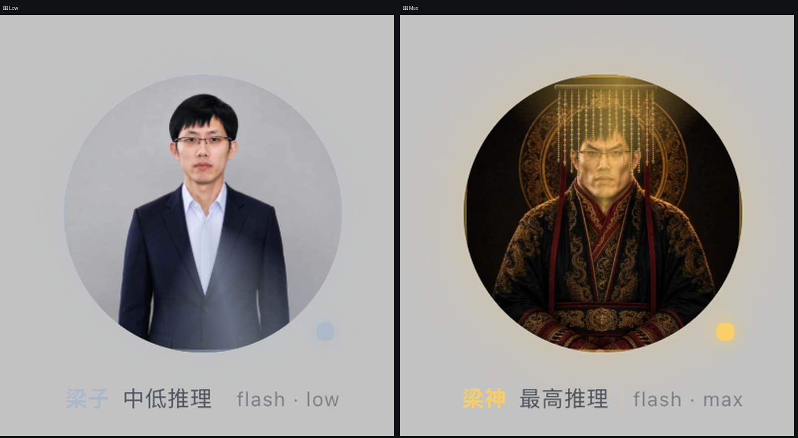
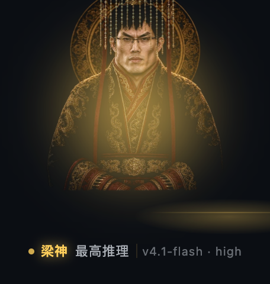
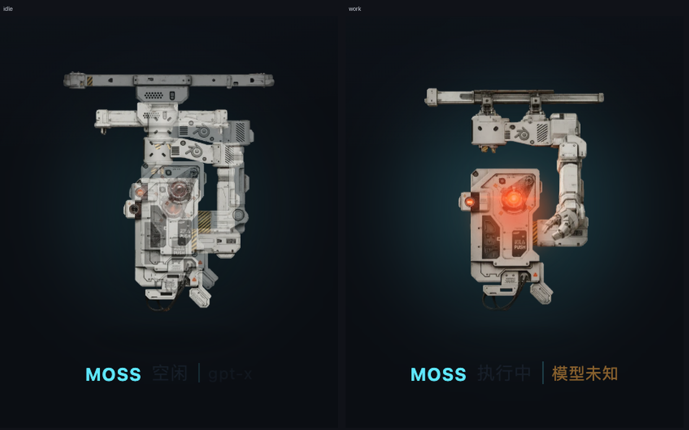

# dsh-pet-liang · 桌宠：梁神 / MOSS

> DeepSeek Harness 插件。右下角一只全息桌宠：用 DeepSeek 自带模型时是**梁神**，推理等级越高形象越"上位"；会话一执行就**换形成 MOSS 并进入工作态**；点一下形象，弹出当前会话的费用明细。
>
> 版本 0.1.0 · 适配 dsh `>=0.2.0-rc.1 <0.3.0-0` · 无运行时依赖、无构建步骤







## 它按什么规则变

| 条件 | 形象 | 状态 |
|---|---|---|
| DeepSeek 自带模型 + 空闲 | 梁神（按推理等级四档） | 待命 / 呼吸 |
| 任意模型 + 会话执行中 | MOSS 工作态（红色摄像眼亮起、金色环） | 执行中（光晕呼吸、指示点闪烁） |
| 非 DeepSeek 模型 + 空闲 | MOSS 空闲 | 待命 |

推理等级 → 形象档位（按当前模型可用档位归一，`off/low/medium/high` 四档为例）：

| 档位 | 称呼 | 画面 |
|---|---|---|
| 最低 | **小梁** | 冷色调、几乎无光晕 |
| 次低 | **梁子** | 中性色、微光 |
| 次高 | **梁圣** | 金色冠冕、金色法轮 |
| 最高 | **梁神** | 满冠、强金色光晕与暗角 |

模型只有单档推理能力时落到中间档（梁子/梁圣之间），不会永远显示极值。

## 三个交互细节

1. **换形动画**：梁神 ↔ MOSS 切换时，形象先溶解、全息扫描线扫过、新形态在光晕闪光里重构（约 780ms）。同角色换档（梁子→梁圣）只做 180ms 淡入，不重放整段换形。
2. **点击看 B 站**：点形象唤起 [dsh-bili-widget](https://github.com/pyf2818/dsh-bili-widget)（推荐安装，直接复用它那套完整浮窗：推荐/热门/排行/精选/关注/AI 频道、搜索、观看历史、迷你模式、专注模式、可拖动可拉伸）。没装它时退回内置的简化列表（热门/排行 + 窗内播放）。
3. **可拖动**：按住形象拖到任意位置，松手记住（`localStorage: dsh-pet-liang:pos`），刷新与重启都保持；拖动不会误触发费用卡，窗口缩放会自动夹回可视区。
4. **不挡操作**：浮动层是 `position:fixed` 的独立节点，不进任何布局流；不点它就不会拦截鼠标。

## B 站小窗是怎么来的

点击形象打开内置的 B 站小窗：**标题栏拖动、右下角缩放、位置/大小写入 localStorage**；顶栏三行：标题+刷新/关闭 / **整行搜索框**（回车或点搜索）/ **频道分类下拉**（全站·动画·音乐·游戏·娱乐·知识·科技·影视·鬼畜·生活·美食）+ 最新/热门/排行 + 清除搜索；列表来自宿主代理的 B 站公开接口，封面走白名单图片代理，点条目在窗内用 `player.bilibili.com` iframe 播放，`← 返回` / `Esc` 逐级退出。

> 早前试过复用 `dsh-bili-widget`：它在本机（macOS）的宿主半会 `spawn curl.exe`（Windows 路径）失败，导致列表为空、播放不可用，而且它自己的窗口状态会和外部拖动打架。已卸载，改为本插件自带窗口。找不到这个元素（没装插件）才退回内置的简化列表：`/api/bili` 代理热门/排行、`/api/bili-img` 只放行 B 站图床、播放用官方 `player.bilibili.com` iframe。

宿主仍保留 `GET /dsh-pet-liang/api/cost`（会话 token 与人民币折算），点击行为已经改成 B 站，费用接口目前没有 UI 入口。

## 安装

```bash
# 桌宠本体
dsh plugin --profile desktop add "link:/Volumes/软件目录/work/zkxh/deepseek/dsh-pet-liang"
# 可选：点桌宠时唤起的完整 B 站浮窗（不装则退回内置简化列表）
dsh plugin --profile desktop add github:pyf2818/dsh-bili-widget
```

重启 DeepSeek Harness 后，右下角出现桌宠。卸载：`dsh plugin --profile desktop remove dsh-pet-liang`。

## 自测

```bash
npm run check   # 两个 JS 文件语法
npm test        # 28 项：宿主路由、token 归一、人民币折算、峰谷、状态决议、四档映射
npm run preview -- --port 4311   # 浏览器预览：真实 client.js + 真实素材 + 样例费用
```

`scripts/preview.mjs` 起的是**同一份** `client/client.js`，只是把宿主换成假 ctx，所以预览里看到的形态、动画、费用卡就是插件产出的那一份。预览页支持 `?tier=1..4`、`?moss=idle|work`、`?cost=1`。

## 素材

| 文件 | 来源 |
|---|---|
| `assets/liang-1..4.webp` | 取自 [liang-intensity-calibrator](https://github.com/Lichtspektrum/liang-intensity-calibrator)（MIT，经 dsh-liang-skin 转制）的四个强度锚点 level-01 / level-10 / level-22 / stage-30 |
| `assets/moss-idle-a.webp` / `moss-idle-b.webp` / `moss-work.webp` | 用同机位三格 sprite 一次生成（保证比例/位置完全一致，只有机械臂角度不同）：收拢 / 抬高 / 前伸；rembg 抠成透明底，同 bbox 裁切对齐 |

立绘与基座都是"深色底 + 发光主体"，因此在 UI 上都用 alpha 抠出来再叠；没有实拍素材，也不含可识别真人的照片。

## 边界

- 素材许可：梁神人像来自上游 MIT 项目，见 [NOTICE.md](./NOTICE.md)。
- **不调用模型**：只用宿主已有的会话状态与用量投影，零额外 token。
- 桌宠挂在会话输入区的 dock 座位上，因此"当前会话"指的是你正打开的那个会话；没有会话时显示 MOSS 空闲兜底。
- 费用是"按价目折算"的核算，不等于账单；企业折扣/协议价请改 `lib/index.js` 的 `PRICES`。
- 形象切档依赖宿主模型目录里的 `reasoning.efforts`；宿主未暴露该字段时按单档处理。
- 模型判定优先读**会话投影 `modelSelection`**（`{lastUsed,next}`，durable，不依赖目录异步加载），其次读会话摘要 `summary.projectionValues.modelSelection`，最后才回退模型目录；推理档位在拿不到目录时按档位名兜底排序。
- 判定结果直接显示在 HUD 右侧的小字（如 `v4.1-flash`）；取不到时显示橙色 `模型未知`。完整判定也写到 `title`（悬停可见）、`data-provider`/`data-tier` 属性与控制台 `[dsh-pet-liang] session=… provider=… model=… effort=… running=… → liang/moss`。
- 状态桥同时注册在两个座位（`conversation.input.dock` 与 `conversation.session.header.utilities`）互为兜底，任一挂载即可。
- 单进程、无持久化：拖拽位置与档位不落盘（除了桌宠自己的位置记忆）。
- 角色是**真透明抠图**（rembg / BRIA RMBG 模型），没有圆形背景、没有底框：立绘直接浮在界面上，底部有柔和投影与渐隐，不会出现硬边。
- 图片本身是**干净的**：所有光效由 CSS 叠加。
- 空闲关节：把机械臂**前臂+手**从底图切出成独立图层（`moss-forearm.webp`），底图对应区域用 OpenCV inpaint 修补（`moss-base.webp`）；前臂层以肘关节为旋转轴（62.89% / 35.55%）做 ±5° 往返（5.2s），是真正的绕轴旋转，不是换图。
- 执行态：隐藏前臂层，切到伸臂帧 `moss-work.webp`，镜头上叠红色脉冲（1.25s）+ 外圈光晕。
- 每个角色**只有一个 img 节点**：早期用两张姿态交叉淡入做关节动画，会同时画出两张不一样姿态的图（重影），已废弃。
- 点桌宠唤起 dsh-bili-widget 后，会自动把它的浮窗拖到桌宠左侧；它自带的粉色悬浮球已隐藏（仍作为唤起锚点）。

## 结构

```
lib/index.js      宿主半：静态资源 + /api/cost + /api/health
client/client.js  浏览器半：状态决议 + 浮动层 + 换形动画 + 费用卡（单文件 ESM，无构建）
assets/           四档梁神 + MOSS 六态 + 全息基座（webp，合计约 0.5 MB）
scripts/          pet-test.mjs（无浏览器自测）、preview.mjs（本地预览）
screenshots/      README 用图
```

## MOSS 3D 模式

MOSS 形象不再用预渲染 PNG，而是**在插件里实时渲染你提供的 550W 模型**：

- 模型：`assets3d/moss.fbx`（4 个材质组 Moss_Main / Moss_arm / Moss_Glass / Moss_Annexes）
- 贴图：4096² 原图压到 512 的 WebP，共 13 张（Base / Normal / Emissive / ORM 打包），合计约 400KB
- 运行时：`three.module.min.js` + `FBXLoader` + `fflate` + `NURBS*`，全部本地托管，不联网
- **三个关节（轴由圆柱拟合算出）**：
  - **J1 上臂轴**：垂直轴，轴心 (−0.40, 79.90, 18.00)，r=5.60，残差 19.6% → 下半部分绕它画圆
  - **J2 中臂轴**：垂直轴，轴心 (32.90, 60.60, 18.00)，r=5.80，残差 35.7% → 中臂以下绕它画圆
  - **J3 主机自身**：**水平 X 轴**，轴心 (·, 13.57, 18.04)，r=6.59，残差 20.6%（绕垂直轴拟合残差 52.3%，故必须是 X 轴）→ 上下点头
  - 层级 `p1(上臂) → p2(中臂) → p3(主机)`：每层转动带着下面整组画圆，主机再叠加自己的点头
  - 手块与前臂一体（归 J2），不单独参与

- **动效脚本**（时间轴驱动，`assets3d/boot.js`）：两套动作段循环，每段含角度与红眼亮度关键帧。

  **空闲态**（5 组 × 30s，共 150s 循环；缓慢、小幅，叠加极缓慢微动避免像卡住）

  | # | 动作组 | 内容 | 红眼 |
  | --- | --- | --- | --- |
  | 1 | 缓慢环视 | 7s 漂到右侧 +6°，停 6s，再 6s 漂到左侧 −5°，回正 | 0.40~0.52 |
  | 2 | 轻微侧望 | 9s 偏到 −4.5° 并停留 12s，再回正 | 0.42~0.48 |
  | 3 | 沉思 | 低头 −3.2°，长停，眼缓慢升到 0.72 再落 | 0.40~0.72 |
  | 4 | 巡视 | 左右各看一次，中间各停 5s | 0.42~0.55 |
  | 5 | 静止休整 | 仅 ±1.2° 的极缓慢漂移 | 0.38~0.44 |

  | 动作段 | 时长 | 内容 |
  | --- | --- | --- |
  | 环视 | 5.6s | J1 +5.5°→−4.5°，轻微点头，眼 0.40~0.48 |
  | 思考 | 4.2s | 低头 −2.6° 并停顿，眼升到 0.72 再落 |
  | 微调 | 3.4s | 小幅反向修正，眼 0.52 |

  **执行态**（10 组 × 20s，共 200s 循环；每组首尾都回到归位姿态，组间不跳变；缓动为「走完再停」的机械节奏）

  | # | 动作组 | 内容 | 红眼 |
  | --- | --- | --- | --- |
  | 1 | 扫视巡检 | 左 20° → 右 20°，各停顿 3s | 转向时 1.00，停顿降到 0.60 |
  | 2 | 点头确认 | 连续三次点头（+10°/−3°） | 每次点头闪 1.05 |
  | 3 | 分步转向 | 右转 24° 停 4.7s → 腕部再压 −7° 停 4.8s → 左转 18° | 移动时 1.00，停顿 0.55 |
  | 4 | 快扫 | 1.2s 一次的高频摆动 ×5，再慢扫两次 | 快速摆动瞬间 1.10 |
  | 5 | 抬头检查 | 抬头 12° 停 5s → 低头 −8° 停 4s | 抬头 1.00 |
  | 6 | 深度思考 | 缓慢漂移并长时间停住 | 缓慢起伏 0.55~0.80 |
  | 7 | 锁定目标 | 左右扫两次后锁定一点，久停 | 锁定瞬间 1.15 |
  | 8 | 反向复核 | 从另一侧再扫一遍，中间停顿 | 移动 0.95，停顿 0.58 |
  | 9 | 微动待机 | 几乎不动，只有细微调整 | 偶发一次闪 1.05 |
  | 10 | 归位 | 轻点头两次后回正 | 0.90 → 0.55 |

  | 动作段 | 时长 | 内容 |
  | --- | --- | --- |
  | 扫描 | 3.4s | J1 −19°→+19° 大范围扫视，转向瞬间眼 1.00 |
  | 点头确认 | 2.2s | J3 点头两次（+11°/−2°），每次点头眼 1.05 |
  | 转向停顿 | 3.6s | 左转 16° 停顿 → 中臂再转 −9° 停顿，停顿期眼降到 0.62 |
  | 快扫 | 2.4s | 高频小幅摆 3 次，每次眼 1.10 |
  | 归位 | 1.2s | 回正，眼降到 0.62 |

  红眼亮度 = 关键帧值 × 呼吸(±4%)；驱动 core 透明度、光晕透明度与缩放、点光源强度。
  截图：`screenshots/22-work-sequence.png`、`screenshots/23-idle-sequence.png`
- **右键拖动瞄准**：按住鼠标右键拖动，机身跟随指针方向转动。**J1/J2 各承担偏航的一半，合计可转满 360°**；**J3 俯仰限幅 ±45°**。
  - 偏航由指针相对宠物中心的方位角决定（`atan2(dx, -dy)`，0=上、顺时针），中心 8px 内保持上一次角度避免抖动
  - 俯仰由垂直偏移映射到 ±45°
  - 拖动期间默认动效**停止**（`animTime` 不推进），松手后 `animTime` 归零，**从第一组动作重新执行**
  - 姿态用 `aimBlend`（每帧 16%）混合，进出无跳变
  - 实现：`assets3d/boot.js` 的 `aim(yawDeg, pitchDeg)`；`client/client.js` 的 `bindAim()`
  - 截图：`screenshots/25-right-drag-aim.png`、`screenshots/27-orbit-360.png`

- **相机**：必须用 3/4 视角（方位角 26°）。正对时绕垂直轴的偏航是「往屏幕里外摆」，肉眼几乎看不出；3/4 下才明显。
- **缓存**：`boot.js` 的请求带 `?v=`，宿主对 `.js` 返回 `no-cache`——之前没带版本，桌面端可能一直执行旧缓存。

- **转动原则**：分段切口所在的平面必须**垂直于转轴**，否则转动时切口两侧会张开。本模型的分段是水平切口（y = 79.9 / 60.6 / 25.0），所以三个关节都只能绕**垂直 Y 轴**转；之前把 J3 设成绕 Z 轴，就是它把机身和手臂撕开的原因。
- **转动序列**（`screenshots/15-joint-poses.png`、`screenshots/16-joint-seam.png`）：按关键帧走具体角度，每段 1.6s 平滑缓动循环：

  | 关键帧 | J1 颈部 | J2 前臂顶 | J3 腕部 |
  | --- | --- | --- | --- |
  | 静止 | 0° | 0° | 0° |
  | 右偏 | +15° | −8° | +6° |
  | 左偏 | −13° | +8° | −6° |
  | 回中 | +6° | −3° | +2.5° |
  | 静止 | 0° | 0° | 0° |

  执行态：每段 1.0s、角度 ×1.25、速度 ×2.6

- **红眼**：模型自带的发光贴图只有 3 个 2px 的 LED 点，主镜头根本没做发光 —— 所以在机身正前方按标定位置加了一层“发光盘 + 径向光晕 + 红色点光”，并**挂在模型根节点上**随模型一起动；空闲暗橙呼吸，执行态转红、变亮、脉冲加快
- 渲染 30fps 上限；切到梁神时暂停渲染循环
- 失败兜底：WebGL / 模型加载失败时自动退回 PNG 立绘（`moss-base.webp` + `moss-forearm.webp`）

调试：`localStorage['dsh-pet-liang:force'] = 'moss'`（或 `'moss-work'`）可强制显示 MOSS，便于在只配了 DeepSeek 的环境里验证。

> ⚠️ 模型与贴图的版权归原权利方（《流浪地球 2》相关美术），仓库里只作为个人主题插件的素材使用；若要公开发布请自行确认授权。
