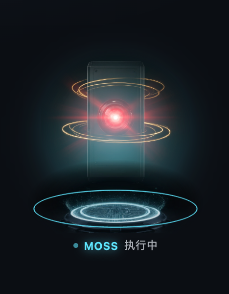

# dsh-pet-liang · 桌宠：梁神 / MOSS

> DeepSeek Harness 插件。右下角一只全息桌宠：用 DeepSeek 自带模型时是**梁神**，推理等级越高形象越"上位"；会话一执行就**换形成 MOSS 并进入工作态**；点一下形象，弹出当前会话的费用明细。
>
> 版本 0.1.0 · 适配 dsh `>=0.2.0-rc.1 <0.3.0-0` · 无运行时依赖、无构建步骤


 

## 它按什么规则变

| 条件 | 形象 | 状态 |
|---|---|---|
| DeepSeek 自带模型 + 空闲 | 梁神（按推理等级四档） | 待命 / 呼吸 |
| 任意模型 + 会话执行中 | MOSS 工作态（红色摄像眼亮起、金色环） | 执行中（光晕呼吸、指示点闪烁） |
| 非 DeepSeek 模型 + 空闲 | MOSS 空闲 | 待命 |

推理等级 → 形象档位（按当前模型可用档位归一，`off/low/medium/high` 四档为例）：

| 档位 | 称呼 | 画面 |
|---|---|---|
| 最低 | **小梁** | 冷色调、几乎无光晕 |
| 次低 | **梁子** | 中性色、微光 |
| 次高 | **梁圣** | 金色冠冕、金色法轮 |
| 最高 | **梁神** | 满冠、强金色光晕与暗角 |

模型只有单档推理能力时落到中间档（梁子/梁圣之间），不会永远显示极值。

## 三个交互细节

1. **换形动画**：梁神 ↔ MOSS 切换时，形象先溶解、全息扫描线扫过、新形态在光晕闪光里重构（约 780ms）。同角色换档（梁子→梁圣）只做 180ms 淡入，不重放整段换形。
2. **点击看费用**：点形象弹出费用卡——会话总价、缓存命中/未命中输入/输出三段 token 与各自金额、模型名、峰谷时段、价目口径。点空白处或再点一次关闭。
3. **可拖动**：按住形象拖到任意位置，松手记住（`localStorage: dsh-pet-liang:pos`），刷新与重启都保持；拖动不会误触发费用卡，窗口缩放会自动夹回可视区。
4. **不挡操作**：浮动层是 `position:fixed` 的独立节点，不进任何布局流；不点它就不会拦截鼠标。

## 费用是怎么算的

| 项 | 来源 / 口径 |
|---|---|
| token 用量 | 宿主 `ctx.sessionController.projections()` 的 `tokenUsage`（`uncachedInputTokens / cacheReadTokens / cacheWriteTokens / outputTokens`），取不到时回退 `list()` |
| 单价 | 人民币 / 百万 token，分 cacheHit / input / output 三档，口径对齐 `dsh-cost-meter` |
| 折算 | `cacheRead × cacheHit 价 + (input − cacheRead) × input 价 + output × output 价` |
| 峰谷 | 北京时间工作日 09:00–12:00、14:00–18:00 记峰时，其余谷时（只提示，不改价） |
| 未知模型 | 回退 Flash 档，并在卡片上写明"默认估价" |

拿不到用量时，卡片明确写"暂时取不到用量"，**不编数字**。

## 安装

```bash
dsh plugin --profile desktop add "link:/Volumes/软件目录/work/zkxh/deepseek/dsh-pet-liang"
```

重启 DeepSeek Harness 后，右下角出现桌宠。卸载：`dsh plugin --profile desktop remove dsh-pet-liang`。

## 自测

```bash
npm run check   # 两个 JS 文件语法
npm test        # 28 项：宿主路由、token 归一、人民币折算、峰谷、状态决议、四档映射
npm run preview -- --port 4311   # 浏览器预览：真实 client.js + 真实素材 + 样例费用
```

`scripts/preview.mjs` 起的是**同一份** `client/client.js`，只是把宿主换成假 ctx，所以预览里看到的形态、动画、费用卡就是插件产出的那一份。预览页支持 `?tier=1..4`、`?moss=idle|work`、`?cost=1`。

## 素材

| 文件 | 来源 |
|---|---|
| `assets/liang-1..4.webp` | 取自 [liang-intensity-calibrator](https://github.com/Lichtspektrum/liang-intensity-calibrator)（MIT，经 dsh-liang-skin 转制）的四个强度锚点 level-01 / level-10 / level-22 / stage-30 |
| `assets/moss-idle.webp` / `moss-work.webp` | qwen-image-3.0 生成：黑色单体积分机 + 红色摄像眼（《流浪地球》里 MOSS/550W 的形态，不是人形机器人）；工作态换成亮起红光 + 金色环那张 |
| `assets/holo-pedestal.webp` | qwen-image-3.0 生成的全息基座，裁成横条并加边缘遮罩 |

立绘与基座都是"深色底 + 发光主体"，因此在 UI 上都用 alpha 抠出来再叠；没有实拍素材，也不含可识别真人的照片。

## 边界

- 素材许可：梁神人像来自上游 MIT 项目，见 [NOTICE.md](./NOTICE.md)。
- **不调用模型**：只用宿主已有的会话状态与用量投影，零额外 token。
- 桌宠挂在会话输入区的 dock 座位上，因此"当前会话"指的是你正打开的那个会话；没有会话时显示 MOSS 空闲兜底。
- 费用是"按价目折算"的核算，不等于账单；企业折扣/协议价请改 `lib/index.js` 的 `PRICES`。
- 形象切档依赖宿主模型目录里的 `reasoning.efforts`；宿主未暴露该字段时按单档处理。
- 判定用的 provider/model 会写到浮动层的 `title`（鼠标悬停可见）和 `data-provider` 属性上；判定异常时看控制台 `[dsh-pet-liang] session=… provider=… model=… → liang/moss`。
- 单进程、无持久化：拖拽位置等偏好不保存（也不打算加）。

## 结构

```
lib/index.js      宿主半：静态资源 + /api/cost + /api/health
client/client.js  浏览器半：状态决议 + 浮动层 + 换形动画 + 费用卡（单文件 ESM，无构建）
assets/           四档梁神 + MOSS 六态 + 全息基座（webp，合计约 0.5 MB）
scripts/          pet-test.mjs（无浏览器自测）、preview.mjs（本地预览）
screenshots/      README 用图
```
